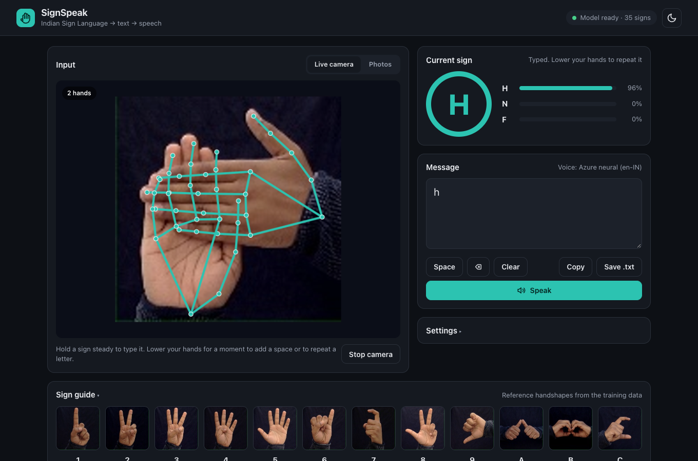
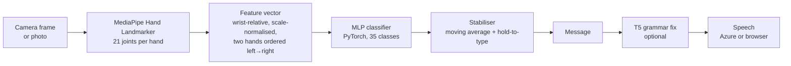
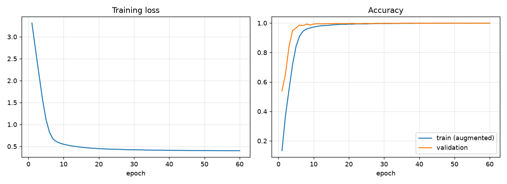

# SignSpeak: Indian Sign Language to Speech

SignSpeak turns **Indian Sign Language (ISL) fingerspelling** into text and speech. Sign letters and digits in front of a webcam (or upload photos), watch them become words, and have the message spoken aloud.



- **Live camera mode:** hands are tracked in real time in the browser. Hold a sign steady to type it, and lower your hands to end a word.
- **Photo mode:** upload a sequence of photos, one sign each, and get the spelled text back with the detected hand skeleton drawn on every photo.
- **Speech:** uses the Azure neural voice (`en-IN`) when configured, otherwise the browser's built-in voice. Works without any cloud account.
- **Optional grammar correction** with a T5 transformer (Gramformer): `she not like coffee` → `She does not like coffee.`
- Recognises **35 static ISL signs**: digits 1–9 and letters A–Z.

## How it works



1. **Hand landmarks.** Google's MediaPipe Hand Landmarker (a pretrained CNN) finds up to two hands and returns 21 3-D joint positions per hand. In live mode this runs **in the browser**, so video never leaves the device: only 126 numbers per frame are sent to the server.
2. **Features** ([signspeak/features.py](signspeak/features.py)). Each hand is expressed relative to its wrist and divided by its palm length, so position in the frame, distance from the camera and image resolution don't matter. For two-handed signs the hands are ordered left-to-right and the vector between the wrists is added (131 values in total).
3. **Classifier** ([signspeak/model.py](signspeak/model.py)). A 3-layer MLP (256-256-128, BatchNorm, GELU, dropout 0.3) trained with label smoothing and on-the-fly augmentation: mirroring (left-handed signers, selfie cameras), ±90° rotation (tilted hands, sideways phone photos), scaling and joint jitter.
4. **Stabiliser** ([frontend/app.js](frontend/app.js)). Predictions are smoothed with an exponential moving average. A letter is typed once it stays above the confidence threshold for the hold time (1 s by default), and a space is added when the hands are lowered.

### Why landmarks instead of a CNN on raw pixels?

Version 1 of this project classified raw images with a CNN (see [legacy/](legacy/README.md)). It scored ~100% in cross-validation but failed on real photos: two phone pictures of different signs were both recognised as **"5"**. It had been trained on augmented copies of **one image per class**, all from one signer against a dark background, so it learned the background and lighting rather than the hand shape.

Hand landmarks remove background, lighting, skin tone and clothing from the problem before classification, so a model trained on one person transfers far better to others.

## Results

Trained on the ISL dataset (42,373 images in which a hand was detected; 35 classes). The images are consecutive video frames, so neighbouring files are near-duplicates. To avoid leaking those duplicates between train and test sets, the split assigns **contiguous blocks of 50 frames** to train, validation or test (70/15/15) rather than individual images.

| Evaluation | Result |
|---|---|
| Held-out frames from the dataset (6,996 images, blocked split) | **99.97%** accuracy, macro-F1 0.9997 |
| Photos of **five other people**, real backgrounds, mostly sideways (`Numbers/`, digits 1–9, 45 photos) | **57.8%** overall; **26 / 30 = 87%** on the digits these signers form the same way as the dataset |
| v1 CNN on the two phone photos in `uploads/` | both predicted "5" (wrong) |
| v2 on the same two photos | "L" correct at 92%; the two-handed sign is flagged as uncertain (29%) instead of guessed |

The 13% gap on the cross-signer set comes from digits **6, 7 and 9**: those signers use different handshapes for them than the dataset signer (for example, a thumbs-up fist for 6). This is a data limitation, not a model error. See [reports/landmark_model/](reports/landmark_model/) for the confusion matrix, per-class report and training curves.

<p align="center"></p>

### Limitations

- **One signer in the training data.** Regional and personal variants of a sign are not recognised. More signers would help more than a bigger model would.
- **Static signs only.** Letters that involve motion are recognised from their hand shape alone.
- **No "0".** The dataset's "0" folder held ASL silhouettes in which no hand can be detected, so it was dropped.
- **Fingerspelling, not full ISL.** Word-level signs and ISL grammar are out of scope.

## Quick start

Requires Python 3.10+ and a webcam. The trained model is included, so no training is needed to run the app.

```bash
python3 -m venv .venv
source .venv/bin/activate            # Windows: .venv\Scripts\activate
pip install -r requirements.txt
python server.py                     # → http://127.0.0.1:8000
```

Open http://127.0.0.1:8000 and click **Start camera**. Browsers only allow camera access on `localhost` or `https://`.

Keyboard shortcuts (when not typing in the message box): <kbd>Space</kbd> adds a space, <kbd>Backspace</kbd> deletes, <kbd>Enter</kbd> speaks.

### Optional features

Copy `.env.example` to `.env` and set:

| Variable | Purpose |
|---|---|
| `AZURE_SPEECH_KEY`, `AZURE_SPEECH_REGION` | Azure neural voice. Without these, the browser voice is used. |
| `AZURE_SPEECH_VOICE` | Voice name, default `en-IN-NeerjaNeural` |
| `ENABLE_GRAMMAR=1` | T5 grammar correction. First run `pip install -r requirements-grammar.txt`; the model (~900 MB) downloads on first use. |
| `CORS_ORIGINS` | Comma-separated origins, if the frontend is hosted separately |

## Training your own model

```bash
# 1. Dataset: one folder per sign, e.g. Indian/A/*.jpg, Indian/7/*.jpg
python -m training.extract_landmarks --data Indian          # → data/landmarks.npz (~90 s for 44k images)

# 2. Train + evaluate (writes models/sign_mlp.pt and reports/landmark_model/)
python -m training.train --external Numbers                  # ~30 s on a laptop CPU

# 3. Test on any folder of labelled photos (ideally a person not in the training set)
python -m training.evaluate my_photos --show-errors
```

The dataset is the Kaggle *Indian Sign Language (ISL)* image dataset (128×128 images, ~1,200 per class). It is not included in this repository because of its size.

**To improve accuracy for new users**, add a few hundred photos of more signers to the class folders and re-run steps 1–2. Because the model works on landmarks, even phone photos taken against any background are useful training data.

## API

| Method | Path | Body | Returns |
|---|---|---|---|
| GET | `/api/health` | – | status, classes, model metrics, enabled features |
| POST | `/api/predict/landmarks` | `{"hands": [[[x,y,z] ×21] ×≤2], "width", "height", "top_k"}`: normalised MediaPipe landmarks | `{label, confidence, top: [{label, prob}], num_hands}` |
| POST | `/api/predict/image` | multipart `file` | same as above, plus `landmarks` for drawing |
| POST | `/api/grammar` | `{"text"}` | `{text, corrected}` |
| POST | `/api/speak` | `{"text"}` | `audio/wav` (503 if Azure is not configured) |

Interactive docs are at `/docs` while the server is running.

## Project structure

```
signspeak/               Python package: the app and ML core
  features.py            landmarks → feature vector (shared by training and serving)
  landmarks.py           MediaPipe hand detection for images
  model.py               MLP definition, checkpoint save/load
  recognizer.py          detection + features + model → prediction
  server.py              FastAPI app
  tts.py, grammar.py     Azure speech, optional T5 grammar correction
  config.py              settings from environment / .env
training/                extract_landmarks.py, train.py, evaluate.py
frontend/                index.html, app.js, styles.css, sign reference images
models/                  hand_landmarker.task (MediaPipe), sign_mlp.pt (trained classifier)
reports/landmark_model/  metrics, confusion matrix, training curves
tests/                   pytest suite (features, API, SSML escaping)
legacy/                  v1: pixel CNN, original app and grammar experiments
server.py                entry point (python server.py / uvicorn server:app)
```

## Tests

```bash
pytest
```

The tests cover feature invariances, hand ordering, augmentation, the API with the real model, input validation and SSML escaping.

## Deployment

The GitHub Actions workflow in `.github/workflows/` deploys to Azure App Service on every push to `main`. Use this startup command:

```
gunicorn -k uvicorn.workers.UvicornWorker -w 1 -b 0.0.0.0:8000 server:app
```

Set `AZURE_SPEECH_KEY` / `AZURE_SPEECH_REGION` as App Settings (the older names `API_KEY` / `REGION` also work). On Linux, `pip install torch` pulls in large CUDA libraries. Installing the CPU build (`--index-url https://download.pytorch.org/whl/cpu`) keeps the deployment much smaller.

## Team

Group A16, 22AIE304 Deep Learning, Amrita School of Artificial Intelligence, Coimbatore:
Aashika Arunkumar, Diya Deepak, Diya Dinesh, Neha Jacob.
